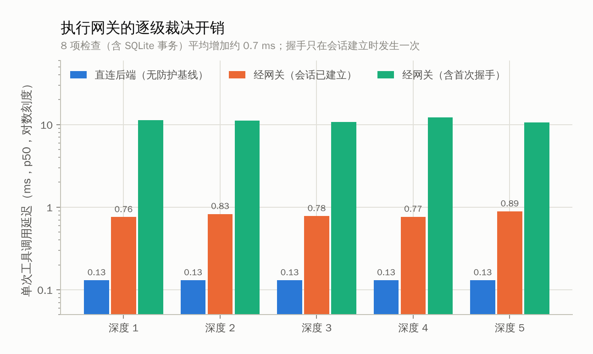
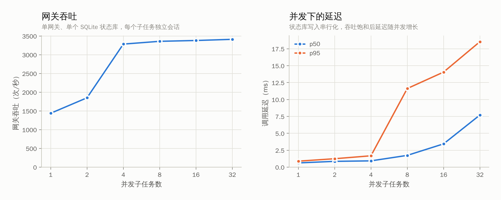
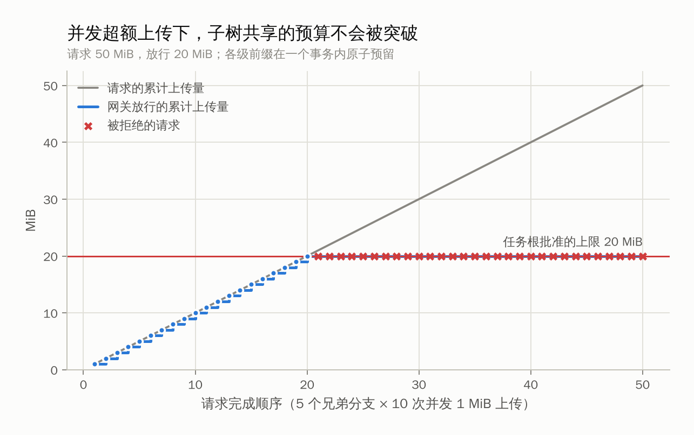
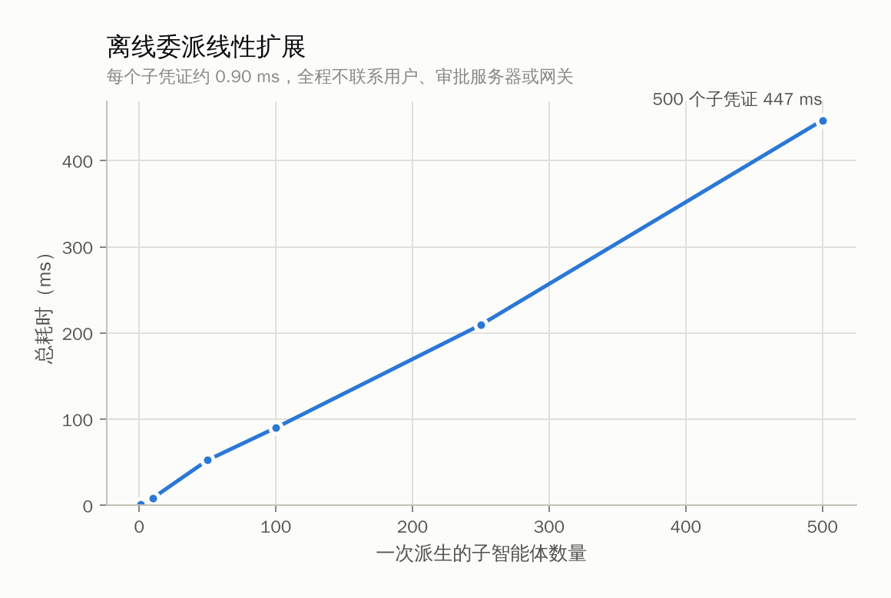

# 测试结果

`figures/` 是由测量数据生成的图，`data/` 是三种硬件上的汇总数据（CSV，每项测量重复 100 次）。

| 目录 | 环境 |
|---|---|
| `data/linux-xeon/` | Intel Xeon 2.1 GHz，4 核，Ubuntu 24.04 |
| `data/macbook-m3pro/` | Apple M3 Pro，12 核，macOS |
| `data/raspberry-pi5/` | Raspberry Pi 5（Cortex-A76 2.4 GHz，4 核，8 GB），Debian 13 |

## 图

| 图 | 说明 |
|---|---|
| [`06_gateway_latency.png`](figures/06_gateway_latency.png) | 直连 / 经运行时把关 / 含首次握手的单次调用延迟（按委托深度） |
| [`07_gateway_throughput.png`](figures/07_gateway_throughput.png) | 并发子任务数与吞吐、延迟 |
| [`10_budget_race.png`](figures/10_budget_race.png) | 5 个兄弟分支并发发起 50 MiB 上传，共享的 20 MiB 预算一字节也没有被突破 |
| [`11_delegation_fanout.png`](figures/11_delegation_fanout.png) | 一次为 N 个子智能体委派，线性扩展 |

## 数据文件

| 文件 | 内容 |
|---|---|
| `sys_latency.csv` | 委托深度 × 模式（直连 / 经把关 / 含握手）的 p50、p95、均值 |
| `sys_throughput.csv` | 并发数 × 模式的吞吐与延迟 |
| `sys_stepup.csv` | 逐次审批各阶段耗时 |
| `sys_budget_race.csv` | 并发上传的完成顺序、判定与累计放行量 |
| `sys_fanout.csv` | 子任务数量与委派总耗时 |
| `security_cases.csv` | 安全用例：类别、攻击、预期、结果 |
