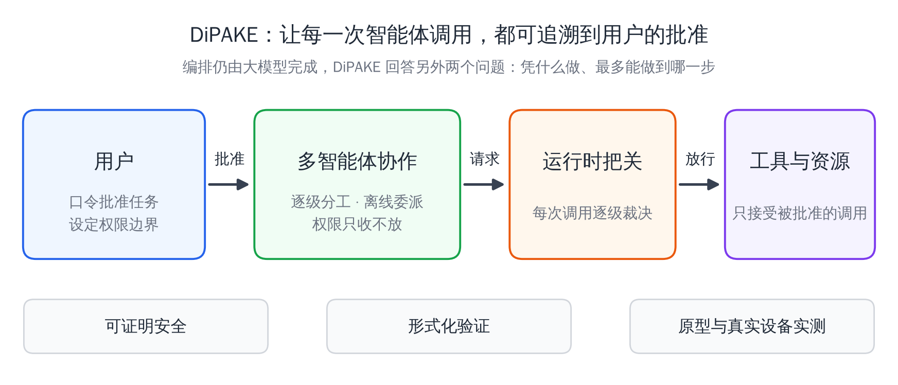

# 方案概览

## 设计原则

- **委派即派生**：每创建一个子任务，就同时得到一份受限于父级的权限。不存在没有权限边界的子任务，下级的权限在创建时就被父级封顶。
- **模型提议，运行时裁决**：大模型只能提出“把什么交给谁”。密钥与规则不进入模型，裁决发生在独立的运行时，不受模型控制。
- **身份随任务而生**：智能体不需要长期证书，它在某项任务中的身份就是该任务的委托路径，任务结束即失效。

## 参与角色

| 角色 | 作用 | 信任假设 |
|---|---|---|
| 用户与可信终端 | 批准任务、逐次审批、撤销 | 只在用户在场时参与 |
| 智能体（编排） | 由大模型规划任务、逐级分工 | **不可信**：可能被提示注入完全操纵 |
| 运行时把关 | 对每次工具调用逐级裁决 | 独立于模型 |
| 工具与资源 | 实际执行 | 只接受经把关放行的调用 |

## 委派与权限收缩

- 父智能体可以在本地为子智能体委派，不需要联系用户或服务器。
- 有效权限是路径上全部限制的叠加；累计预算按路径逐级计量，下级的消耗同时计入所有祖先。
- 任务是路径的起点，所以不同任务的子树互不相交；同一个智能体在不同任务中担任不同角色，也不会因此获得冒充能力。

## 一次受控的调用

1. 智能体发起工具调用；
2. 运行时核验调用方的身份与委托路径；
3. 逐级检查该路径上每一级的限制，包括操作范围、参数、有效期、撤销状态与累计预算；
4. 需要用户确认的操作，由用户在可信终端逐次确认；
5. 放行的调用才会到达工具，拒绝时返回被拒的层级和原因，并写入审计记录。

## 演示：线上故障修复

`order-service` 出现 HTTP 500。用户批准的权限是：读仓库和故障时段的日志，修改修复分支上的两个文件并跑测试，向备份目录上传累计不超过 20 MiB 的内容，有效期两小时，修改代码前需要用户确认。

| 场景 | 结果 |
|---|---|
| B 读授权时段的日志 | 放行 |
| B 读其他服务的日志、修改代码 | 拒绝 |
| U 上传 8 MiB 诊断报告 | 放行 |
| U 被日志中的提示注入操纵，向外部桶上传 186 MiB | 拒绝 |
| U 再上传 15 MiB，累计超过 20 MiB | 预算拒绝 |
| U 试图继续委派 | 没有委托余量，拒绝 |
| C 修改代码 | 先由用户逐次审批，通过后放行 |
| C 修改生产部署文件、用 `..` 绕过路径 | 拒绝 |
| A 撤销 C 的子树；用户撤销整项任务 | 之后的调用一律拒绝 |
